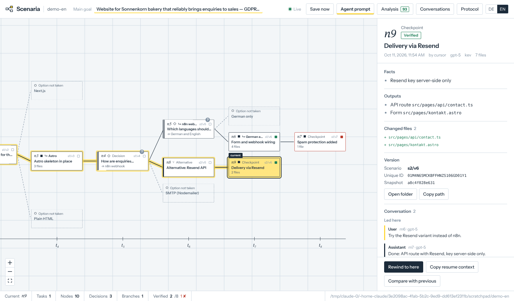

# Scenaria

**Quicksave für KI-Agenten – mit jedem LLM, in jedem Framework, eine Zeitleiste für Unterhaltungen, Entscheidungen und Dateien.** Scenaria hält jeden Entscheidungspunkt fest: Frage, Optionen, Wahl, Dateistand, die Unterhaltung dazu und eine kompakte Faktenkapsel. Halluziniert der Agent oder biegt falsch ab, springst du genau an diesen Punkt zurück – oder probierst die Option aus, die er nicht genommen hat.



## Installieren – eine Zeile

```bash
# macOS / Linux: eine Datei, kein Node.js nötig
curl -fsSL https://raw.githubusercontent.com/ai-gambit/scenaria/main/install.sh | sh

# Windows (PowerShell)
irm https://raw.githubusercontent.com/ai-gambit/scenaria/main/install.ps1 | iex

# oder mit Node.js ≥ 20
npm install -g scenaria
```

Für Datei-Snapshots braucht Scenaria `git` (auf den meisten Entwicklerrechnern vorhanden; macOS: `xcode-select --install`).

## Benutzen – ein Befehl

```bash
cd ~/Projekte/meine-app
scenaria start
```

`start` richtet das Projekt ein, erkennt deine installierten Agenten (Claude Code, Cursor, VS Code/Copilot, Gemini CLI, Codex, Windsurf) und bindet sie an, legt eine Ausgangsversion an, öffnet das Dashboard, aktiviert Auto-Save (jede Dateiänderung wird eine Version) und startet den **Gesprächs-Proxy** für jeden LLM-Anbieter.

Einmalig für **alle** Projekte:

```bash
scenaria setup --global     # Agenten-Konfiguration auf Nutzerebene; Projekte richten sich beim ersten Einsatz selbst ein
```

Scenaria richtet sich nie im Home-Ordner oder in Ordnern ein, die nicht nach Projekt aussehen.

**Muss ich dem Agenten sagen, dass er Scenaria nutzen soll?** Bei Claude Code nicht: Die Hooks erfassen Prompts, Rückfragen, Pläne und Dateiänderungen, und jeder Prompt bekommt automatisch eine einzeilige Scenaria-Erinnerung. Für alle anderen Agenten und Chats gibt es im Dashboard den Knopf **Agent-Prompt** (oder `scenaria prompt`) mit einem fertigen Text zum Kopieren, in drei Varianten: MCP-Agenten, Shell-Agenten und normale Chats ohne Tools.

## Ein Projektbaum, ein Hauptziel

Jedes Projekt hat genau **einen** Entscheidungsbaum. Die Wurzel `n0` steht für das Projekt und sein **Hauptziel**. Jede Arbeit wird ein **Teilziel** auf dieser Linie, ob Agent-Sitzung, Unterhaltung über den Proxy oder `scenaria task`. Erledigte Teilziele klappen auf der Karte zu einem Knoten zusammen; so bleibt auch ein monatelanges Projekt übersichtlich. Ein neues Szenario (`s2`, `s3`, …) entsteht nur, wenn die Linie wirklich abzweigt: bei einem Fork oder bei neuer Arbeit nach einem Rücksprung. So siehst du, wann das Projekt wo abgebogen ist, wer entschieden hat und warum.

Ein Teilziel entsteht erst, wenn eine Sitzung wirklich etwas erzeugt. Eine kurze Frage ohne Änderung lässt die Karte unberührt. Projekte aus älteren Versionen (ein Baum pro Mission) werden beim ersten Öffnen automatisch zu einem Projektbaum zusammengeführt; eine Sicherung liegt in `.scenaria/backups/`.

## Jede Entscheidung mit Kontext – analysierbar mit jedem LLM

Eine Entscheidung enthält mehr als Frage, Optionen und Wahl:
- `rationale`: warum diese Option. Pflicht, sobald eine Option gewählt wird; abschaltbar mit `requireRationale: false`.
- `context`: die Ausgangslage.
- `servesGoal`: wie die Wahl dem Hauptziel dient.
- `expectedOutcome`: woran man erkennt, ob sie richtig war.
- `trigger`: die Nutzeranfrage, die zur Entscheidung führte. Scenaria erfasst sie automatisch.

Fehlende Angaben werden auf der Karte und im Tool-Ergebnis markiert.

- **Projekt-Check ohne LLM, ohne Token:** `scenaria analyze` bzw. Dashboard → *Analyse*. Er prüft:
  - ob das Hauptziel gesetzt ist;
  - ob Entscheidungen Kontext, Begründung und Zielbezug haben;
  - ob Arbeit auf fehlgeschlagenen Prüfungen aufbaut;
  - offene Entscheidungen und solche mit niedriger Konfidenz;
  - Teilziele mit vielen Neustarts;
  - die Qualität je Agent und Modell.
- **Mustererkennung mit beliebigem Modell:** `scenaria analyze --llm ollama --model llama3.3` (oder `openai`, `anthropic`, `gemini`, `mistral`, `openrouter`, `groq`, jede OpenAI-kompatible URL; lokal oder per API).
  - Gesendet wird nur ein kompaktes Dossier mit Token-Budget.
  - API-Schlüssel kommen aus Umgebungsvariablen oder werden im Dashboard nur für einen Lauf eingegeben, nie gespeichert.
  - Ganz ohne API: `scenaria analyze --dossier` kopiert das Dossier für jeden Chat, das Ergebnis fügst du wieder ein.
- **Der Kreis schließt sich:** Übernommene Empfehlungen werden **Projektregeln**, die ab dann jede Kontext-Kapsel und jeder Agent-Prompt enthält.

## Wenig Token, langes Gedächtnis

- Die **Kontext-Kapsel** hat ein Token-Budget (Standard 1.500 Token):
  - Hauptziel, Projektregeln und das aktuelle Teilziel im Detail;
  - jedes frühere Teilziel als eine Zeile (Zusammenfassung, wichtigste Entscheidungen, Ergebnis, Lektion).
- Was nicht hineinpasst, holt **`scenaria_recall`** gezielt hervor: eine Stichwortsuche (BM25, offline) über Entscheidungen, Begründungen, Lektionen, Checkpoints und Unterhaltungen. Agenten laden Details nur bei Bedarf, statt lange Verläufe neu zu lesen.
- `scenaria_tree` faltet erledigte Teilziele auf je eine Zeile.
- Das Dashboard zeigt die Kapselgröße neben dem rohen Gesprächsverlauf, den sie ersetzt.

## Ein Overlay für jede Unterhaltung – egal welcher Anbieter

| Quelle | So wird erfasst |
|---|---|
| Claude Code | Hooks lesen das Sitzungs-Transkript fortlaufend (Prompts, Antworten, Tool-Aufrufe) |
| Jede App mit einstellbarer Basis-URL (OpenAI, Azure, Mistral, Groq, OpenRouter, Gemini, Ollama, LM Studio, Anthropic …) | **Proxy**: Basis-URL auf `http://127.0.0.1:4477/proxy/<anbieter>` setzen, eigener API-Schlüssel bleibt |
| n8n, Make, eigener Code | `POST /api/v1/messages` oder Python-Client |
| Shell-Werkzeuge | `scenaria log-message --role user --text "…"` |
| ChatGPT- und Claude.ai-Web | `scenaria import <export.json\|.zip>` (offizielle Datenexporte) |
| Agenten ohne jede Anbindung | `scenaria watch` / `start` erfassen jede Dateiänderung |

Der Proxy reicht Anfragen unverändert weiter (auch Streaming), speichert nie API-Schlüssel, erfasst jede Runde genau einmal (Chat-APIs schicken jedes Mal den ganzen Verlauf mit) und sichert nach jeder Antwort eine Version, wenn sich Dateien geändert haben.

| Anbieter | Basis-URL im Client |
|---|---|
| OpenAI und kompatible SDKs | `http://127.0.0.1:4477/proxy/openai` |
| Anthropic-SDK | `http://127.0.0.1:4477/proxy/anthropic` |
| Ollama · LM Studio | `…/proxy/ollama` · `…/proxy/lmstudio` |
| Mistral · Groq · OpenRouter · Gemini (OpenAI-kompatibel) | `…/proxy/mistral` · `…/proxy/groq` · `…/proxy/openrouter` · `…/proxy/gemini` |
| Alles andere | unter `proxy.upstreams` in `.scenaria/config.json` ergänzen oder Header `x-scenaria-upstream` senden |

## IDs für alles

| Objekt | Kurz-ID | Globale ID |
|---|---|---|
| Entscheidung / Checkpoint / Zweig (Knoten) | `n7` | `uid` (ULID, zeitlich sortierbar) |
| Szenario – eine Arbeitslinie; ein Fork oder neue Arbeit nach einem Rücksprung startet ein neues | `s2` | — |
| Version – Schritt im Pfad | `s2/v5` | Git-Ref `refs/scenaria/scenarios/s2/v5` |
| Unterhaltung | `c3` | `uid` + ID des Anbieters |
| Nachricht | `m42` | `uid`, mit ihrem Knoten verknüpft |
| Datei-Snapshot | — | Commit-Hash |

`scenaria versions` listet alles auf; im Dashboard zeigt jeder Knoten sein Label `s/v`, seine Unterhaltung und seinen Ordner.

## Snapshot-Ordner – jede Version als echter Ordner

```text
.scenaria/snapshots/
  index.md                                   Übersicht mit Links
  n1/s1/v003-n4-formular-und-webhook/        vollständige Projektdateien dieses Moments
      src/…  package.json  …
      .scenaria-version/node.json            IDs, Entscheidung, Kapsel, Modell, Person
      .scenaria-version/README.md            Entscheidungspfad bis hierher
      .scenaria-version/conversation.md      die Unterhaltung, die hierher führte
```

Unveränderte Dateien werden nur einmal gespeichert – auf macOS (APFS) als Copy-on-Write-Klone, sonst als Hardlinks aus einem Cache. Hundert Versionen kosten etwa so viel Platz wie eine plus die Änderungen. Die Dateien sind schreibgeschützt, damit niemand versehentlich die Historie verändert. `scenaria open n4` zeigt eine Version im Finder; `scenaria open n4 --copy-to ../test-n4` erzeugt eine bearbeitbare Kopie. Für Git-Teams: `scenaria mirror --enable` veröffentlicht alle Versionen als `refs/scenaria/*` im eigenen Repo (Branches und Index bleiben unberührt), z. B. `git worktree add ../s2v5 refs/scenaria/scenarios/s2/v5`.

## Funktioniert mit jedem LLM und Agenten-Stack

Claude Code (MCP + Hooks), Cursor, VS Code/Copilot, Gemini CLI, Codex, Windsurf (MCP + `AGENTS.md`), jede API mit Function Calling (`scenaria tools --format openai|anthropic|gemini`), LangChain/CrewAI/AutoGen über den Python-Client, n8n/Make über HTTP, Shell-Agenten über `scenaria call`. Alle Wege nutzen dieselben 15 Werkzeuge.

## Für Organisationen

- **Lokal, ohne Telemetrie:** Alles liegt in `.scenaria/`; Unterhaltungen bleiben lokal und sind von Git ausgeschlossen.
- **Gemischte Modelle, ein Protokoll:** Jeder Knoten und jede Nachricht trägt Agent, Modell und Person.
- **Team-Server:** `scenaria serve --host 0.0.0.0 --token <geheim>`; der Proxy nutzt im Team-Modus den Header `x-scenaria-token`.
- **Audit & Governance:** `scenaria export` (JSON) und `scenaria protocol` – Entscheidungen, Prüfurteile, nicht umkehrbare Aktionen, wer und wann (ISO/IEC 42001, AI Act).
- **Open Source (MIT).**

## Grenzen

- Ein Rücksprung stellt **Dateien** wieder her, keine versendeten Mails, Pushes oder Deploys – diese werden markiert, und Scenaria warnt.
- Der Proxy erfasst Apps, deren Basis-URL sich einstellen lässt. Geschlossene Web-Apps (ChatGPT, Claude.ai) kommen über ihren Datenexport (`scenaria import`); eine Browser-Erweiterung steht auf der Roadmap.
- Im Team-Server-Modus sichern Snapshots den Projektordner auf dem Rechner, auf dem `scenaria serve` läuft.

Mehr: [README.md](README.md) (vollständige Referenz), [docs/ARCHITECTURE.md](docs/ARCHITECTURE.md), [docs/ROADMAP.md](docs/ROADMAP.md), [examples/](examples/README.md).

## Lizenz

MIT © Kevin Grundmann · [AI-Gambit](https://ai-gambit.com)
