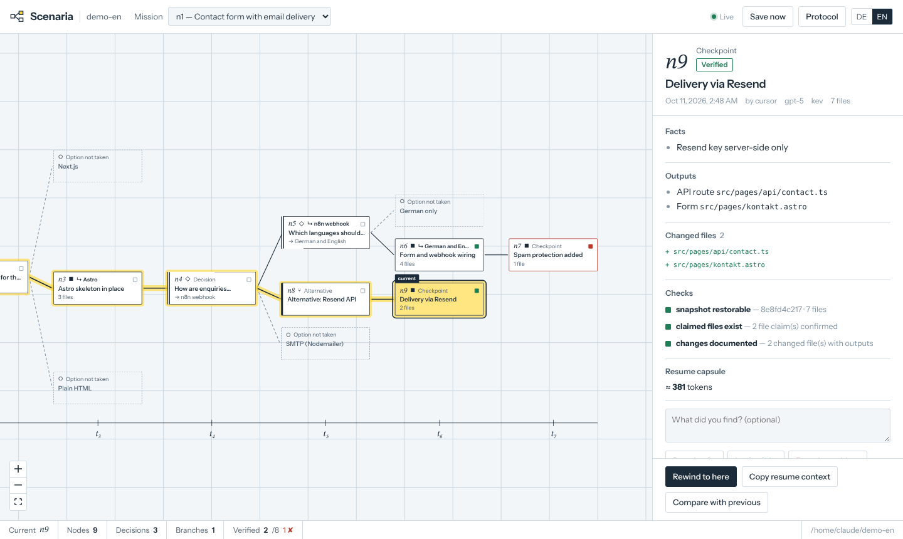

# Scenaria

**Quicksave for AI agents — any LLM, any framework.** Scenaria records every decision point of an agent run: the question, the options, the choice, the files and a compact fact capsule. When an agent hallucinates or takes a wrong turn, you jump back to exactly that point, or try the option it didn't take.

The model doesn't matter. Claude, GPT, Gemini, Mistral, Llama via Ollama, or your own fine-tune: they all share the same decision tree, the same verification and the same audit trail. A local dashboard draws the run as a scenario tree.



[Deutsche Version](README.de.md)

## Why

Long agent tasks fail in the middle. Undo tools for files already exist (git, editor checkpoints, agent-specific rewinds), but they save by **time** and live inside a single vendor's tool. Scenaria saves by **decision**, and it works across tools:

- **Decision points as first-class objects.** Each one holds the question, all options considered, the chosen one, the rationale, assumptions and confidence. Options that weren't taken stay on the map, and you can explore any of them later, even with a different model.
- **Rewind = files + context.** Rewinding restores the files. It also gives the agent a resume capsule containing *only* the path that led there. Abandoned branches are left out; at most a one-line lesson carries over. So a hallucination doesn't leak into the next attempt.
- **Nothing gets lost.** Unsaved work is autosaved before every rewind, so a rewind can be undone too. Ignored files that would be overwritten are backed up as well.
- **Verification on the same objects.** Deterministic checks catch claimed files that don't exist, undocumented changes, low-confidence decisions and irreversible side effects. A verifier records a verdict per node, and that verifier can be a different model from a different vendor.
- **Fewer tokens.** The agent resumes from a capsule of a few hundred tokens instead of re-reading a long transcript.

## Works with every LLM and agent stack

| You use … | Connect via | Setup |
|---|---|---|
| **Claude Code** | MCP + hooks (automatic capture of prompts, clarifying questions, plan approvals, risky commands) | `scenaria init --for claude` |
| **Cursor · VS Code/Copilot · Gemini CLI · Codex** | MCP + `AGENTS.md` / `GEMINI.md` rules | `scenaria init --for cursor,vscode,gemini,codex` |
| **Windsurf · Cline · Zed · any MCP client** | MCP | `scenaria init --for windsurf` / `--for generic` prints the config |
| **OpenAI · Azure OpenAI · Mistral · Groq · OpenRouter · Ollama · vLLM · LM Studio** | Function calling + HTTP | `scenaria tools --format openai`, [example](examples/openai_compatible_agent.py) |
| **Anthropic API · Gemini API** | Function calling + HTTP | `scenaria tools --format anthropic` / `gemini` |
| **LangChain · LlamaIndex · CrewAI · AutoGen · custom Python** | [Python client](clients/python/scenaria_client.py) (stdlib only) | `scenaria serve` |
| **n8n · Make · Zapier · Power Automate** | HTTP API | `scenaria serve`, [examples](examples/README.md) |
| **Aider · Open Interpreter · shell agents** | CLI | `scenaria call scenaria_checkpoint '{"title":"…"}'` |
| **Agents without any tool support** | File watcher | `scenaria watch` |

All paths use **one tool registry**: the same 13 tools with the same validation behave identically over MCP, HTTP, CLI and function calling.

## For organizations

- **Local-first, no telemetry.** Everything lives in `.scenaria/` inside the project. Nothing leaves the machine unless you run a team server. This keeps it GDPR-friendly and safe for client code.
- **Mixed models, one audit trail.** Every node records `agent`, `model` and `user`. Compare vendors on the same task, or let one model build and another verify.
- **Team server.** `scenaria serve --host 0.0.0.0 --token <secret>` gives the dashboard and API to a team (Bearer token or browser cookie). Locally it only answers on 127.0.0.1 and is protected against DNS rebinding and cross-site requests.
- **Audit and governance.** `scenaria export` produces a machine-readable JSON (nodes and events) for BI or governance tools, and `scenaria protocol` writes a human-readable protocol. Decisions, verdicts, irreversible actions, who and when are all included, which supports ISO/IEC 42001 and AI Act documentation.
- **Rules for every agent.** `AGENTS.md`, `CLAUDE.md` and `GEMINI.md` blocks tell agents when to record decisions. A ready-made [verifier prompt](templates/rules/verifier-prompt.md) works with any LLM.
- **Open source (MIT).** Self-host it, audit it and extend it.

## Quick start

Requires Node.js ≥ 20 and git.

```bash
git clone <this repo> scenaria && cd scenaria
npm install
npm run build
npm link            # puts the `scenaria` command on your PATH
```

In the project your agent works on:

```bash
cd ~/Projects/my-app
scenaria init --for claude,cursor     # or: vscode, gemini, codex, windsurf, generic, all
scenaria ui                           # scenario map at http://127.0.0.1:4477
```

To look around first, `npm run demo` builds a demo project. It has a hallucinated step, a rewind and an alternative explored by a second agent and model. Open it with `scenaria ui --root scenaria-demo`; add `-- --lang en` to the demo command for English content.

## Tools

| Tool | Purpose |
|---|---|
| `scenaria_status` | Orientation: mission, HEAD, unsaved changes |
| `scenaria_start_mission` | Root node with main goal and brief |
| `scenaria_decide` | Record a decision point (snapshot included) |
| `scenaria_choose` | Resolve a decision recorded as open |
| `scenaria_checkpoint` | Quicksave with fact capsule |
| `scenaria_tree` / `scenaria_get_node` | Inspect the tree |
| `scenaria_context` | Resume capsule for any node |
| `scenaria_rewind` | Jump back (files + HEAD), with a lesson |
| `scenaria_fork` | Explore another option of a past decision |
| `scenaria_diff` | Diff between nodes or against the working tree |
| `scenaria_verify` | Checks + verdict (passed / warning / failed) |
| `scenaria_last_good` | Safest rewind target |

Manual MCP config for any client:

```json
{ "mcpServers": { "scenaria": { "command": "scenaria", "args": ["mcp"],
  "env": { "SCENARIA_ROOT": "/path/to/project", "SCENARIA_AGENT": "my-agent", "SCENARIA_MODEL": "my-model" } } } }
```

## What Claude Code captures automatically

With Claude Code, hooks capture events without the agent having to call anything:

| Source | Captured as |
|---|---|
| First prompt of a session | Mission with goal and brief |
| `AskUserQuestion` answers | Decision node, the user's answer = chosen option |
| Plan approval (`ExitPlanMode`) | Decision node with the plan |
| Risky Bash (`rm -rf`, `git reset --hard`, …) | Autosave right before it |
| External effects (`git push`, deploys, `curl -X POST`, …) | Flagged *irreversible* on the next node |
| End of each turn with file changes | Checkpoint with bullets from the agent's final message |

Other agents record through the tools, guided by `AGENTS.md`. `scenaria watch` adds automatic saves for any agent.

## CLI

```text
scenaria init [--for <agents>]          scenaria status | tree | show <id> | context [id]
scenaria ui | serve [--host --token]    scenaria rewind <id> [--lesson ..] [--no-files]
scenaria mcp | watch                    scenaria fork <decisionId> <option>
scenaria mission "<title>" --goal ..    scenaria diff <from> [to|working]
scenaria decide "<q>" -o A -o B --chosen A --why .. --confidence 0.7
scenaria checkpoint "<title>" --out .. --fact .. [--if-changed]
scenaria verify <id> [--status ..] [--run]     scenaria last-good
scenaria tools [--format openai|anthropic|gemini|json]
scenaria call <tool> '<json>'           scenaria export [--format json|md]  scenaria protocol
```

Global flags: `--root`, `--json`, `--agent`, `--model`, `--user`.

## Where things live

```text
.scenaria/
  config.json      settings (exclude patterns, verifyCommand, context options)
  state.json       HEAD and active mission
  nodes/n7.json    one file per node, the source of truth
  events.jsonl     append-only event log
  kb/n7.md         Obsidian-compatible note per node (local knowledge base)
  protocol.md      human-readable audit protocol
  shadow.git/      private snapshot repository (git-ignored)
```

Snapshots live in a private shadow repository. Your own `.git`, branches, index and stash are never touched, and your `.gitignore` is honored.

## Limits

- Rewind restores **files**. It can't undo sent emails, pushes, deploys or database writes. These are flagged as irreversible, and Scenaria warns you before rewinding past them.
- The *conversation* is rewound by handing the agent the resume capsule. Agent transcripts are not edited.
- In team-server mode, file snapshots cover the project folder on the machine that runs `scenaria serve`.
- If you move this repository, run `scenaria init --for …` again in your projects, because configs point to its absolute path.

See [docs/ARCHITECTURE.md](docs/ARCHITECTURE.md), [docs/ROADMAP.md](docs/ROADMAP.md) and [examples/](examples/README.md).

## License

MIT © Kevin Grundmann · [AI-Gambit](https://ai-gambit.com)
